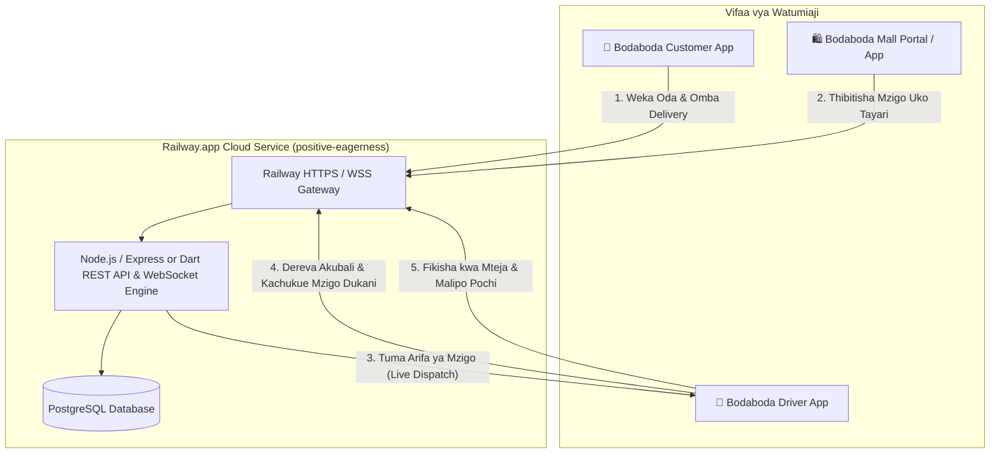
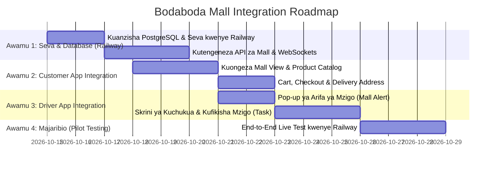

# 📋 Bodaboda Express & Bodaboda Mall — Mpango Kazi wa Muungano (Integration Roadmap & DB Schema)

**Mradi:** Bodaboda Express Ecosystem (Customer App + Driver App + Bodaboda Mall + Railway Backend)  
**Mazingira ya Majaribio (Pilot Target):** Railway.app (`positive-eagerness`) + PostgreSQL  
**Tarehe:** Oktoba 2026  
**Hadhira:** Timu ya Waendelezaji (Tech & Management Team)

---

## 📌 1. Muhtasari wa Mradi (Executive Summary)

Mradi huu unalenga kupanua mfumo wa sasa wa **Bodaboda Express** (ambao ulikuwa unafanya safari za kawaida za abiria na vifurushi) ili kuungana moja kwa moja na **Bodaboda Mall** (Soko la mtandaoni / Multi-vendor Marketplace). 

### Malengo Makuu:
1. **Kwa Mteja (Customer App):** Mteja ataweza kuona bidhaa za Bodaboda Mall ndani ya app yake, kuweka oda, na kuomba dereva wa Bodaboda Express amletee mzigo.
2. **Kwa Dereva (Driver App):** Dereva atapata arifa (Push Notification / Live Pop-up) pindi oda ya Mall inapokuwa tayari kuchukuliwa dukani na kupelekwa kwa mteja. Dereva atalipwa ada ya usafirishaji (Delivery Fee) kwenye pochi yake.
3. **Kwa Seva (Backend & Database):** Seva moja kuu iliyounganishwa na **PostgreSQL** itasimamiwa na kupelekwa kwenye **Railway.app** kwa ajili ya majaribio ya moja kwa moja (Pilot Testing).

---

## 🏗️ 2. Mchoro wa Muundo wa Mfumo (Architecture Diagram)



---

## 🗄️ 3. Muundo Kamili wa Database (PostgreSQL Schema)

Database hii inachukua safari za kawaida za abiria (Rides) na mizigo ya dukani (Mall Orders & Deliveries) bila mgongano.

```sql
-- ==========================================================
-- 1. EXTENSIONS & ENUMS
-- ==========================================================
CREATE EXTENSION IF NOT EXISTS "uuid-ossp";

-- Aina za Watumiaji
CREATE TYPE user_role AS ENUM ('customer', 'driver', 'vendor', 'admin');

-- Hali ya Dereva
CREATE TYPE driver_status AS ENUM ('offline', 'online', 'busy');

-- Hali ya Safari ya Kawaida
CREATE TYPE ride_status AS ENUM ('requested', 'accepted', 'arrived', 'in_progress', 'completed', 'cancelled');

-- Hali ya Oda ya Bodaboda Mall
CREATE TYPE mall_order_status AS ENUM (
    'pending_payment',
    'paid',
    'store_preparing',
    'ready_for_pickup',
    'driver_assigned',
    'driver_picked_up',
    'delivered',
    'cancelled'
);

-- Njia za Malipo
CREATE TYPE payment_method AS ENUM ('cash', 'mpesa', 'tigopesa', 'airtel_money', 'wallet');

-- ==========================================================
-- 2. WATUMIAJI (USERS & AUTH)
-- ==========================================================
CREATE TABLE users (
    id UUID PRIMARY KEY DEFAULT uuid_generate_v4(),
    full_name VARCHAR(120) NOT NULL,
    phone_number VARCHAR(20) UNIQUE NOT NULL,
    email VARCHAR(120) UNIQUE,
    password_hash VARCHAR(255) NOT NULL,
    role user_role DEFAULT 'customer',
    avatar_url TEXT,
    created_at TIMESTAMP WITH TIME ZONE DEFAULT CURRENT_TIMESTAMP,
    updated_at TIMESTAMP WITH TIME ZONE DEFAULT CURRENT_TIMESTAMP
);

-- Wasifu wa Dereva (Driver Specific Details)
CREATE TABLE driver_profiles (
    id UUID PRIMARY KEY DEFAULT uuid_generate_v4(),
    user_id UUID REFERENCES users(id) ON DELETE CASCADE UNIQUE,
    plate_number VARCHAR(20) NOT NULL UNIQUE,
    motorcycle_model VARCHAR(50) NOT NULL,
    license_number VARCHAR(50) NOT NULL,
    status driver_status DEFAULT 'offline',
    current_lat DOUBLE PRECISION,
    current_lng DOUBLE PRECISION,
    rating NUMERIC(3,2) DEFAULT 5.00,
    wallet_balance NUMERIC(12,2) DEFAULT 0.00,
    fuel_wallet_balance NUMERIC(12,2) DEFAULT 0.00,
    is_verified BOOLEAN DEFAULT FALSE,
    updated_at TIMESTAMP WITH TIME ZONE DEFAULT CURRENT_TIMESTAMP
);

-- ==========================================================
-- 3. BODABODA MALL (MADUKA NA BIDHAA)
-- ==========================================================
CREATE TABLE vendors (
    id UUID PRIMARY KEY DEFAULT uuid_generate_v4(),
    user_id UUID REFERENCES users(id) ON DELETE CASCADE,
    store_name VARCHAR(150) NOT NULL,
    store_category VARCHAR(60) NOT NULL, -- e.g., 'Vipuri vya Pikipiki', 'Vyakula', 'Electronics'
    phone_number VARCHAR(20) NOT NULL,
    pickup_address TEXT NOT NULL,
    lat DOUBLE PRECISION NOT NULL,
    lng DOUBLE PRECISION NOT NULL,
    logo_url TEXT,
    is_active BOOLEAN DEFAULT TRUE,
    created_at TIMESTAMP WITH TIME ZONE DEFAULT CURRENT_TIMESTAMP
);

CREATE TABLE products (
    id UUID PRIMARY KEY DEFAULT uuid_generate_v4(),
    vendor_id UUID REFERENCES vendors(id) ON DELETE CASCADE,
    title VARCHAR(200) NOT NULL,
    description TEXT,
    price NUMERIC(12,2) NOT NULL,
    stock_quantity INT DEFAULT 0,
    image_url TEXT,
    category VARCHAR(60),
    is_available BOOLEAN DEFAULT TRUE,
    created_at TIMESTAMP WITH TIME ZONE DEFAULT CURRENT_TIMESTAMP
);

-- ==========================================================
-- 4. ODA ZA BODABODA MALL & DISPATCH YA DEREVA
-- ==========================================================
CREATE TABLE mall_orders (
    id UUID PRIMARY KEY DEFAULT uuid_generate_v4(),
    order_number VARCHAR(30) UNIQUE NOT NULL, -- e.g., 'MALL-88421'
    customer_id UUID REFERENCES users(id),
    vendor_id UUID REFERENCES vendors(id),
    subtotal_amount NUMERIC(12,2) NOT NULL,
    delivery_fee NUMERIC(12,2) NOT NULL,
    total_amount NUMERIC(12,2) NOT NULL,
    status mall_order_status DEFAULT 'pending_payment',
    payment_method payment_method NOT NULL,
    payment_status VARCHAR(30) DEFAULT 'unpaid',
    
    -- Sehemu ya Kupakua na Kufikisha
    pickup_address TEXT NOT NULL,
    pickup_lat DOUBLE PRECISION NOT NULL,
    pickup_lng DOUBLE PRECISION NOT NULL,
    
    delivery_address TEXT NOT NULL,
    delivery_lat DOUBLE PRECISION NOT NULL,
    delivery_lng DOUBLE PRECISION NOT NULL,
    
    order_notes TEXT,
    created_at TIMESTAMP WITH TIME ZONE DEFAULT CURRENT_TIMESTAMP,
    updated_at TIMESTAMP WITH TIME ZONE DEFAULT CURRENT_TIMESTAMP
);

CREATE TABLE mall_order_items (
    id UUID PRIMARY KEY DEFAULT uuid_generate_v4(),
    order_id UUID REFERENCES mall_orders(id) ON DELETE CASCADE,
    product_id UUID REFERENCES products(id),
    quantity INT NOT NULL,
    unit_price NUMERIC(12,2) NOT NULL,
    total_price NUMERIC(12,2) NOT NULL
);

-- Kazi ya Usafirishaji ya Dereva (Mall Delivery Task)
CREATE TABLE mall_delivery_tasks (
    id UUID PRIMARY KEY DEFAULT uuid_generate_v4(),
    order_id UUID REFERENCES mall_orders(id) ON DELETE CASCADE UNIQUE,
    driver_id UUID REFERENCES driver_profiles(id),
    assigned_at TIMESTAMP WITH TIME ZONE,
    picked_up_at TIMESTAMP WITH TIME ZONE,
    delivered_at TIMESTAMP WITH TIME ZONE,
    driver_earnings NUMERIC(12,2) NOT NULL, -- Pesa anayolipwa dereva (Delivery fee - system commission)
    delivery_otp VARCHAR(6), -- OTP ya kumalizia mzigo kwa mteja
    cancellation_reason TEXT,
    status VARCHAR(30) DEFAULT 'searching_driver' -- searching, accepted, en_route_pickup, picked_up, delivered
);

-- ==========================================================
-- 5. SAFARI ZA KAWAIDA ZA ABIRIA (PASSENGER RIDES)
-- ==========================================================
CREATE TABLE passenger_rides (
    id UUID PRIMARY KEY DEFAULT uuid_generate_v4(),
    customer_id UUID REFERENCES users(id),
    driver_id UUID REFERENCES driver_profiles(id),
    pickup_location TEXT NOT NULL,
    pickup_lat DOUBLE PRECISION NOT NULL,
    pickup_lng DOUBLE PRECISION NOT NULL,
    dropoff_location TEXT NOT NULL,
    dropoff_lat DOUBLE PRECISION NOT NULL,
    dropoff_lng DOUBLE PRECISION NOT NULL,
    fare NUMERIC(10,2) NOT NULL,
    distance_km NUMERIC(5,2),
    status ride_status DEFAULT 'requested',
    payment_method payment_method DEFAULT 'cash',
    created_at TIMESTAMP WITH TIME ZONE DEFAULT CURRENT_TIMESTAMP
);

-- ==========================================================
-- 6. MIKATABA YA MALIPO NA WALLET (TRANSACTIONS)
-- ==========================================================
CREATE TABLE wallet_transactions (
    id UUID PRIMARY KEY DEFAULT uuid_generate_v4(),
    user_id UUID REFERENCES users(id),
    amount NUMERIC(12,2) NOT NULL,
    transaction_type VARCHAR(40) NOT NULL, -- 'ride_earning', 'mall_delivery_earning', 'withdrawal', 'fuel_topup'
    reference_id UUID, -- Inaweza kuwa ride_id au order_id
    phone_network VARCHAR(30), -- 'M-Pesa', 'Tigo Pesa', 'Airtel Money'
    status VARCHAR(20) DEFAULT 'completed',
    created_at TIMESTAMP WITH TIME ZONE DEFAULT CURRENT_TIMESTAMP
);
```

---

## 🔄 4. Mtiririko wa Mawasiliano (API & WebSocket Events)

Ili dereva na mteja wajue kinachoendelea moja kwa moja bila ku-refresh simu:

| Hatua | Nani Anaanzisha? | Aina ya Tukio (Event) | Nani Anapokea? |
| :--- | :--- | :--- | :--- |
| **1. Oda Mpya** | Mteja (`bodaboda_customer`) | `HTTP POST /api/mall/orders` | Seva (Backend) |
| **2. Duka Limethibitisha** | Duka / Mall Admin | `HTTP POST /api/mall/orders/:id/ready` | Seva inatafuta madereva wa karibu |
| **3. Arifa ya Dereva** | Seva (Backend WebSocket) | `MALL_DELIVERY_OFFER` | Madereva waliopo karibu na duka (`bodaboda_driver`) |
| **4. Dereva Kukubali** | Dereva (`bodaboda_driver`) | `MALL_DELIVERY_ACCEPT` | Seva & Mteja |
| **5. Kuchukua Mzigo** | Dereva | `ORDER_STATUS_PICKED_UP` | Mteja anapokea arifa: *"Dereva yupo njiani na mzigo wako"* |
| **6. Kufikisha Mzigo** | Dereva na Mteja | `ORDER_STATUS_DELIVERED` (na OTP) | Seva inahakiki OTP & inaingiza fedha kwenye pochi ya dereva |

---

## 🗓️ 5. Mpango Kazi (Roadmap & Phases)



### 🔹 Awamu ya 1: Railway Backend & PostgreSQL Setup (Siku 1 - 3)
1. Kufungua huduma ya **PostgreSQL** ndani ya mradi wako wa `positive-eagerness` kwenye Railway.
2. Kuweka schema ya hapo juu ya PostgreSQL (Users, Products, Orders, Delivery Tasks).
3. Kutengeneza API endpoints za:
   - Orodha ya bidhaa na maduka (`GET /api/mall/products`).
   - Kutengeneza oda na kukokotoa nauli ya delivery (`POST /api/mall/orders`).
   - WebSocket handler ya kutuma kazi ya mzigo kwa dereva wa karibu.

### 🔹 Awamu ya 2: Muungano kwenye Customer App (`bodaboda_customer`) (Siku 4 - 6)
1. **Mall Gateway:** Kuweka kitufe au kadi maridadi ya "Bodaboda Mall" kwenye Dashboard na Droo ya menyu.
2. **Katalogi ya Bidhaa:** Skrini ya kuvinjari bidhaa kwa makundi (Electronics, Spare Parts, Vyakula n.k.).
3. **Cart & Delivery Checkout:** Mteja akichagua bidhaa, mfumo unachukua anwani yake ya ramani (kutumia Google Maps) na kuhesabu nauli ya bodaboda itakayomletea.
4. **Order Status Screen:** Kufuatilia dereva anapoelekea dukani na anapomletea mzigo.

### 🔹 Awamu ya 3: Muungano kwenye Driver App (`bodaboda_driver`) (Siku 7 - 9)
1. **Mall Delivery Incoming Modal:** Arifa yenye sauti na pop-up inayoonyesha:
   - *Kichwa cha habari:* "📦 Mzigo wa Bodaboda Mall"
   - *Jina la duka na umbali wa kwenda dukani (Pickup)*
   - *Eneo la mteja (Dropoff)*
   - *Pesa atakayopata dereva (Delivery Fee, mfano: TZS 3,500)*
2. **Delivery Task Execution Screen:**
   - Ramani inayomwongoza dereva kwenda dukani.
   - Namba ya simu ya duka (kupiga kwa mbofyo mmoja).
   - Kitufe cha *"Nimechukua Mzigo"* (Confirm Pickup).
   - Ramani ya kumfikishia mteja na kitufe cha *"Nimemkabidhi Mteja"* (Uthibitisho wa OTP).
3. **Wallet Update:** Pesa ya mzigo inaingizwa papo hapo kwenye `wallet_screen.dart`.

### 🔹 Awamu ya 4: Majaribio ya Moja kwa Moja (Live Pilot Test) (Siku 10 - 12)
1. Kutoa toleo jipya la APK za Customer na Driver zikiwa zimeunganishwa moja kwa moja kwenye Railway URL (mfano: `https://positive-eagerness.up.railway.app`).
2. Kufanya mtihani halisi barabarani:
   - Mtu mmoja anaagiza bidhaa kupitia Customer App.
   - Dereva aliyepo karibu anapokea arifa kwenye Driver App yake.
   - Dereva anafuata mzigo na kuupeleka.

---

## 🚀 6. Hatua za Kusanidi Railway.app (Mradi wako: `positive-eagerness`)

1. **Hatua 1:** Kwenye dashboard ya Railway (iliyopo kwenye picha uliyotuma): bonyeza **`+ New`** (juu kulia).
2. **Hatua 2:** Chagua **Database ➔ Add PostgreSQL**. Railway itatengeneza Database na kukupa `DATABASE_URL`.
3. **Hatua 3:** Tutaweka codebase ya backend ndani ya folda la `backend/` ikiwa na `Dockerfile` tayari kuunganishwa na GitHub au Railway CLI.
4. **Hatua 4:** Seva itakupa link ya umma (Public Domain) yenye SSL (`https://...`) ambayo tutaiweka ndani ya apps zote mbili za simu.
